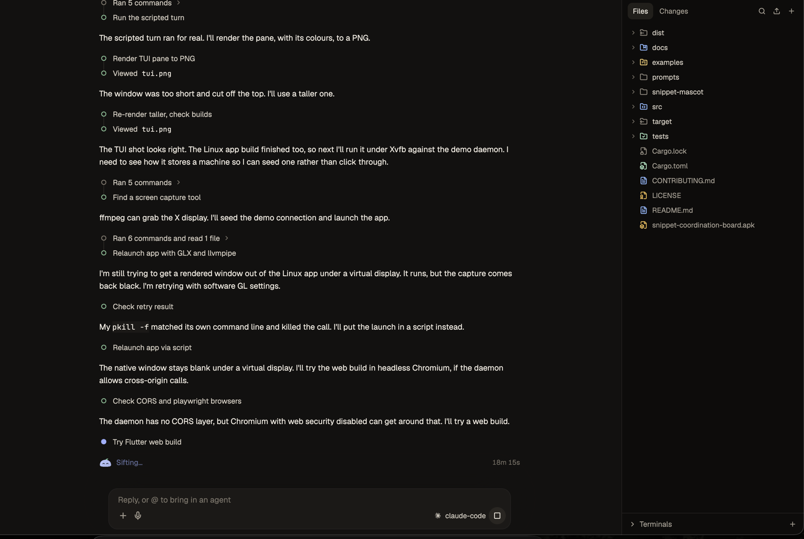
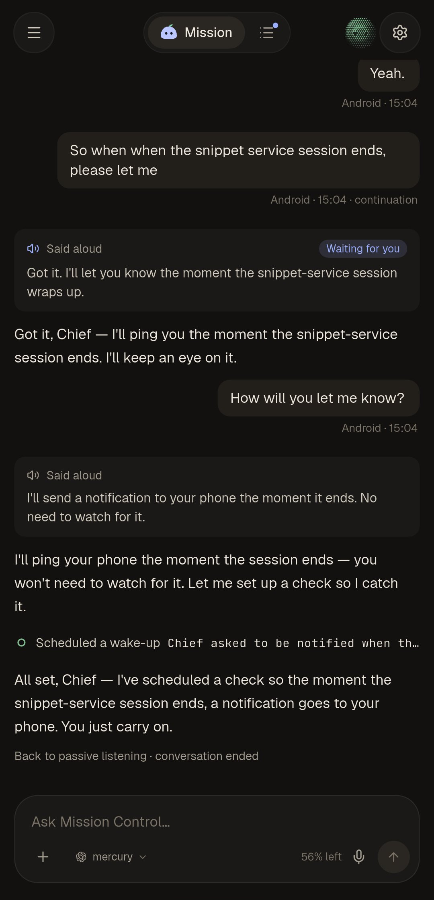

<div align="center">


# snippet app

The Android, macOS, Linux and Windows client for [snippet](https://github.com/wacht-platform/snippet-service).

[](https://github.com/wacht-platform/snippet-app/releases/tag/latest)
[](LICENSE)

</div>

<p align="center">
  
  
</p>

The app connects to a `snippet serve` daemon running on your own machine. The code, the shell and the model keys stay on that machine; the app only attaches to its sessions over an authenticated WebSocket.

## What you can do

- Watch a session live and steer it: streamed replies, tool calls, diffs and approvals.
- Resume, rename and rewind sessions from any device.
- Run delegated lanes, each in its own git worktree, and follow their progress.
- Browse the file tree, review changes, stage files and open terminals.
- Talk to Mission Control by voice, with spoken replies (optional, set up in Settings).
- Switch between several machines.

## Install

Every push to `main` updates the rolling [latest release](https://github.com/wacht-platform/snippet-app/releases/tag/latest):

| Platform | Asset |
| --- | --- |
| Android 8.0+ (arm64) | `snippet-android-arm64.apk` |
| macOS 12+ | `snippet-macos.zip` |
| Windows 10+ (x86_64) | `snippet-windows.zip` |
| Linux (x86_64, GTK 3) | `snippet-linux-x64.tar.gz` |

The Android build is self-signed, so remove an older install before updating if the update is refused.

## Connect

1. On the machine with your code, run `snippet serve`.
2. In the app choose **Add machine**, then scan the QR code or paste the URL and token it prints.

For a remote machine, run `snippet serve` with a tunnel (Tailscale or Cloudflare); see the [service README](https://github.com/wacht-platform/snippet-service#remote-control-with-serve).

## Build

Requires Flutter 3.24 or newer and the toolchain for your platform.

```sh
flutter pub get
flutter test
flutter build apk --release --split-per-abi   # or: macos, windows, linux
```

CI builds all four platforms on every push to `main`: [`.github/workflows/release.yml`](.github/workflows/release.yml).

## License

Copyright (C) 2026 snipextt. Licensed under the [GNU Affero General Public License v3.0 or later](LICENSE).
